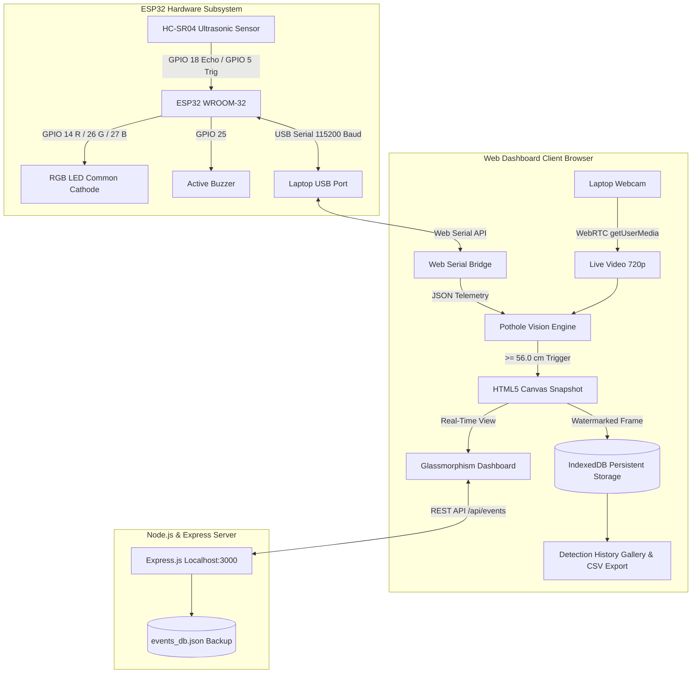
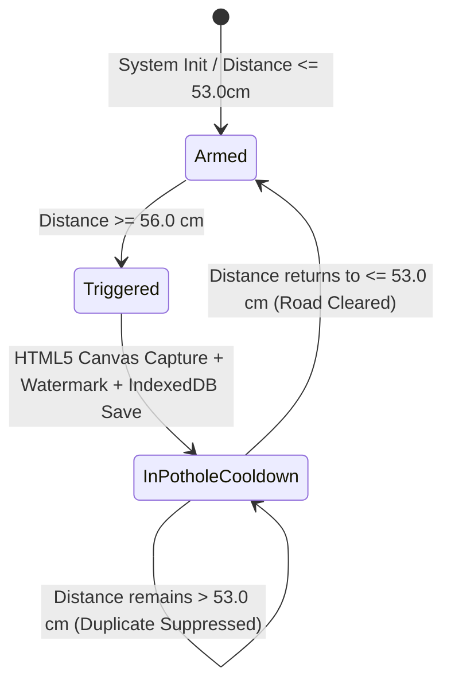

# ESP32 Smart Pothole Detection & Real-Time Camera Monitoring System

An end-to-end intelligent road surface monitoring system combining an **ESP32 microcontroller**, **HC-SR04 ultrasonic distance sensor**, **RGB LED (Common Cathode)**, **Active Buzzer**, **Laptop/USB Webcam**, and a **Glassmorphism Web Dashboard** using the **HTML5 Web Serial API**, **WebRTC MediaStream API**, **Canvas API**, and **IndexedDB persistent storage**.

---

## 📑 Table of Contents
1. [System Architecture](#system-architecture)
2. [Hardware Components & Pinout](#hardware-components--pinout)
3. [Distance Detection & Zone Logic](#distance-detection--zone-logic)
4. [Camera Auto-Capture & Debounce State Machine](#camera-auto-capture--debounce-state-machine)
5. [Firmware Setup (Arduino IDE)](#firmware-setup-arduino-ide)
6. [Web Dashboard Setup (Node.js & Localhost:3000)](#web-dashboard-setup-nodejs--localhost3000)
7. [Hardware Verification & Testing Suite](#hardware-verification--testing-suite)
8. [Troubleshooting Guide](#troubleshooting-guide)
9. [Vercel Deployment Notes](#vercel-deployment-notes)

---

## 1. System Architecture



---

## 2. Hardware Components & Pinout

### Required Components
- **ESP32 Dev Module (WROOM-32)**
- **HC-SR04 Ultrasonic Distance Sensor**
- **RGB LED (Common Cathode)**
- **Active 5V / 3.3V Buzzer**
- **Current Limiting Resistors**: $3 \times 220\Omega$ or $330\Omega$ (for Red, Green, Blue pins of the LED)
- **Voltage Divider Resistors**: $1 \times 1\text{k}\Omega$ and $1 \times 2\text{k}\Omega$ (for HC-SR04 Echo)
- **Breadboard & Jumper Wires**
- **Micro-USB / USB-C Data Cable**
- **Laptop Webcam** or external USB Webcam

### Complete Pin Connection Table

| Component | Pin | ESP32 GPIO | Description / Notes |
| :--- | :--- | :--- | :--- |
| **HC-SR04** | VCC | **VIN (5V)** | Powered from USB 5V rail |
| | GND | **GND** | Ground reference |
| | TRIG | **GPIO 5** | 10 $\mu\text{s}$ trigger pulse output |
| | ECHO | **GPIO 18** | **Through Voltage Divider!** (5V $\rightarrow$ 3.3V) |
| **RGB LED** | RED | **GPIO 14** | In series with $220\Omega$ / $330\Omega$ resistor |
| | GREEN | **GPIO 26** | In series with $220\Omega$ / $330\Omega$ resistor |
| | BLUE | **GPIO 27** | In series with $220\Omega$ / $330\Omega$ resistor |
| | Cathode | **GND** | Longest leg connected to Ground |
| **Active Buzzer** | Positive (+) | **GPIO 25** | Active buzzer generates audible alert on HIGH |
| | Negative (-) | **GND** | Ground connection |
| **Laptop Webcam** | USB / Integrated | -- | Auto-requested in browser via `getUserMedia` |

### ⚠️ Voltage Divider for HC-SR04 Echo (Critical)
The HC-SR04 operates at 5V logic. Its **ECHO** pin outputs a 5V pulse, whereas ESP32 GPIO pins are rated for **3.3V maximum**. Exposing GPIO 18 to 5V can degrade or permanently damage your ESP32.
```
HC-SR04 ECHO (5V Pulse)
          |
         [1kΩ Resistor]
          |
          +----------> ESP32 GPIO 18 (Receives 3.33V Safe Logic)
          |
         [2kΩ Resistor]
          |
         GND
```
$$V_{\text{out}} = 5\text{V} \times \frac{2\text{k}\Omega}{1\text{k}\Omega + 2\text{k}\Omega} = 3.33\text{V}$$

---

## 3. Distance Detection & Zone Logic

The system continuously samples road depth variations and classifies road conditions into 4 strict zones:

| Zone | Distance Range | RGB LED State | Active Buzzer State | Camera Capture | Road Condition |
| :--- | :--- | :--- | :--- | :--- | :--- |
| **ZONE 1 – SAFE** | $0.0 \text{ to } 50.0 \text{ cm}$ | **OFF** | **OFF** | No Capture | Smooth / Normal Road |
| **ZONE 2 – NORMAL** | $> 50.0 \text{ to } 55.0 \text{ cm}$ | **GREEN ON** | **OFF** | No Capture | Slight Ground Dip |
| **ZONE 3 – POTHOLE WARNING**| $> 55.0 \text{ to } 60.0 \text{ cm}$ | **BLUE ON** | **INTERMITTENT** (150ms ON / 150ms OFF) | **AUTO CAPTURE** (at $\ge 56.0\text{ cm}$) | Pothole Detected |
| **ZONE 4 – CRITICAL DANGER** | $> 60.0 \text{ cm}$ | **RED ON** | **CONTINUOUS ALERT** | **AUTO CAPTURE** (if not already captured) | Deep Hazardous Crater |

---

## 4. Camera Auto-Capture & Debounce State Machine



1. **Auto-Initialization**: When the website loads, webcam access is automatically requested via `navigator.mediaDevices.getUserMedia()`. Once granted, continuous 720p live preview starts immediately without capturing images.
2. **Auto-Trigger Threshold**: When road depth increases to **$\ge 56.0\text{ cm}$**, the system triggers a single high-resolution frame grab.
3. **Single Capture Guarantee**: Exactly **one** image is captured per pothole event. Duplicate captures are strictly suppressed while the vehicle remains over the depression.
4. **Re-Arming Rule**: The capture engine re-arms **only** when the measured distance drops back to **$\le 53.0\text{ cm}$**.

---

## 5. Firmware Setup (Arduino IDE)

1. Open **Arduino IDE** (v2.0 or higher recommended).
2. Install the ESP32 board package:
   - Go to `File` $\rightarrow$ `Preferences` $\rightarrow$ `Additional Boards Manager URLs`.
   - Add: `https://raw.githubusercontent.com/espressif/arduino-esp32/gh-pages/package_esp32_index.json`
   - Go to `Tools` $\rightarrow$ `Board` $\rightarrow$ `Boards Manager`, search for `esp32` and click **Install**.
3. Open `esp32_pothole_detection.ino`.
4. Connect your ESP32 to your laptop using a data-capable USB cable.
5. In `Tools`:
   - **Board**: `ESP32 Dev Module`
   - **Port**: Select the COM port corresponding to your ESP32 (e.g., `COM3`, `COM4`, `/dev/ttyUSB0`)
   - **Upload Speed**: `921600` or `115200`
6. Click **Upload** ($\rightarrow$).
7. Once upload completes, verify output in Arduino Serial Monitor at **115200 baud**. You should see:
   ```json
   {"system":"ESP32_POTHOLE_SYSTEM_BOOT","status":"READY","baud":115200}
   ```
8. **Close the Arduino Serial Monitor** so the COM port is free for the Web Serial browser connection!

---

## 6. Web Dashboard Setup (Node.js & Localhost:3000)

### Prerequisites
- Node.js (v18+ recommended)
- Google Chrome, Microsoft Edge, or Opera (required for Web Serial API support)

### Running the System
1. Open PowerShell or Terminal in the project root:
   ```powershell
   cd c:\Users\JEYAKRISHNAN\OneDrive\Desktop\pathole
   ```
2. Install dependencies:
   ```powershell
   npm install
   ```
3. Start the Node.js server:
   ```powershell
   npm start
   ```
4. Open your browser and navigate to:
   ```
   http://localhost:3000
   ```
5. Click **"Allow"** when prompted for camera permissions.
6. Click **"CONNECT ESP32"**, select your ESP32 COM port in the browser popup, and click **Connect**.
7. Observe real-time sensor distance, LED indicator, buzzer waves, and the 0–80cm depth gauge!

---

## 7. Hardware Verification & Testing Suite

Click the **"Hardware Testing Suite"** tab on the dashboard to access the 8 independent verification modules per specification:

| Test ID | Test Name | Procedure | Pass Criteria |
| :--- | :--- | :--- | :--- |
| **TEST 1** | **ESP32 Connection** | Click *Verify Connection* | Port open at 115200 baud, packets $> 0$ |
| **TEST 2** | **Ultrasonic Sensor** | Click *Verify Sensor Health* | Measurement in range $2\text{ to }400\text{ cm}$, no timeout |
| **TEST 3** | **RGB LED Hardware** | Click *Test RED*, *GREEN*, *BLUE* | User visually confirms illumination on GPIO 14, 26, 27 |
| **TEST 4** | **Active Buzzer** | Click *Short*, *Intermittent*, *Continuous* | User audibly confirms sound generation on GPIO 25 |
| **TEST 5** | **Webcam Stream** | Click *Verify Webcam Stream* | `readyState === 'live'`, resolution $> 0 \times 0$ |
| **TEST 6** | **Manual Test Capture** | Click *MANUAL TEST CAPTURE* | Frame grabbed, watermarked **TEST IMAGE**, excluded from history |
| **TEST 7** | **Auto Trigger Logic** | Click *Verify State Machine* | Simulates trigger at $\ge 56\text{ cm}$, re-arm at $\le 53\text{ cm}$ |
| **TEST 8** | **Dashboard & Storage** | Click *Verify Dashboard Pipeline* | IndexedDB functional, `/api/status` responding, DOM nodes bound |

> [!IMPORTANT]
> **Strict Verification Guarantee**: The system initializes all tests to `NOT TESTED / UNTESTED`. It will **never** display `ALL TESTS PASSED` unless every hardware actuator, sensor, and software logic test has been individually verified.

---

## 8. Troubleshooting Guide

### 1. Web Serial Port "Failed to open serial port" or COM Port Missing
- Ensure the Arduino Serial Monitor or any other terminal application (PuTTY, TeraTerm) is **closed**. Only one application can access the COM port at a time.
- Verify USB cable is a **data cable** (not a charge-only cable).
- Install CP2102 or CH340 USB-to-UART drivers if your computer does not recognize the ESP32.

### 2. Webcam Access Denied / Inactive
- In Google Chrome / Edge, click the camera icon on the left side of the address bar (`http://localhost:3000`).
- Ensure permission is set to **Allow**.
- Click the **"Grant Permission & Retry"** button in the webcam box.

### 3. Ultrasonic Sensor Displays `--` or "Timeout"
- Check that HC-SR04 **VCC** is connected to **VIN (5V)**, not 3.3V (HC-SR04 requires 5V to fire ultrasonic pulses).
- Verify voltage divider on ECHO (GPIO 18).
- Ensure TRIG is on GPIO 5.

### 4. RGB LED Not Lighting Up
- Verify that your RGB LED is **Common Cathode** (longest pin to GND).
- If using Common Anode, the common pin must connect to 3.3V and signal logic is inverted.
- Ensure current limiting resistors ($220\Omega$ to $330\Omega$) are in series with GPIO 14, 26, and 27.

---

## 9. Vercel Deployment Notes

The project includes `vercel.json` configured for serverless deployment of the dashboard and backend endpoints.

> [!NOTE]
> Hardware communication (Web Serial API and Webcam `getUserMedia`) runs **locally in the client browser** using secure browser APIs. When deployed on Vercel or any HTTPS host, Web Serial and WebRTC function seamlessly in supported desktop browsers (Chrome, Edge, Opera).

---

## 10. License & Attribution
- Developed for Smart City Road Safety & IoT Monitoring.
- MIT License.
